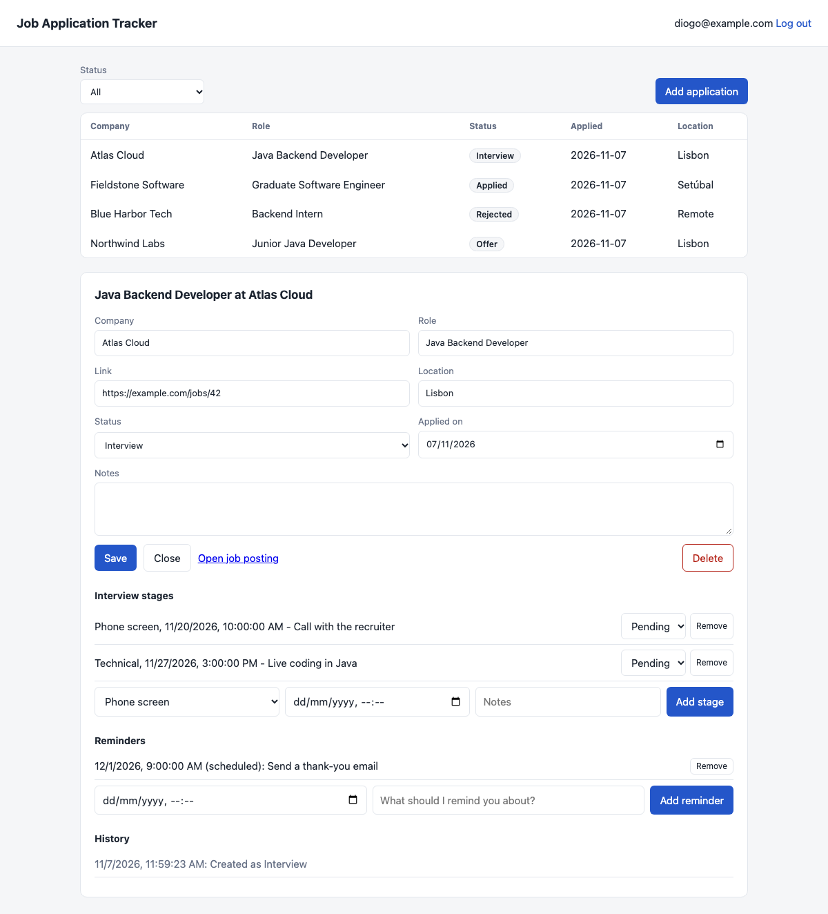

# Job Application Tracker

[](https://github.com/zzdiogo/job-application-tracker/actions/workflows/ci.yml)
[](LICENSE)

A self-hosted app for keeping a job search organized: track every application, its interview stages and its history, and get email reminders for follow-ups.

Built with **Java 21, Spring Boot, Spring Security, PostgreSQL and Flyway**.



*The companies shown are made up.*

## Features

- **Application tracking:** company, role, link, location, status, date and notes, with filtering by status
- **Interview stages:** phone screen, technical, HR, on-site and final, each with a date, outcome and notes
- **Status history:** an automatic record of every status change
- **Email reminders:** scheduled follow-ups, retried up to 5 times if sending fails
- **Accounts:** login with hashed passwords and signed tokens, and each user can only reach their own data
- **REST API:** JSON API with validation and consistent error responses, plus a small web page that uses it

## Getting started

### With Docker

You need [Docker](https://docs.docker.com/get-docker/).

```bash
git clone https://github.com/zzdiogo/job-application-tracker.git
cd job-application-tracker
cp .env.example .env    # On Windows: copy .env.example .env
```

Fill in `POSTGRES_PASSWORD` and `JWT_SECRET` in `.env`, then start it:

```bash
docker compose up -d --build
```

Open <http://localhost:8080> and register.

### For development

You need Java 21 and Maven. This uses a local file database, with no other setup:

```bash
mvn spring-boot:run -Dspring-boot.run.profiles=dev
```

## Configuration

| Variable | Required | Description |
| --- | --- | --- |
| `DATABASE_URL`, `DATABASE_USERNAME`, `DATABASE_PASSWORD` | Yes | PostgreSQL connection (set for you by Docker Compose) |
| `JWT_SECRET` | Yes | Signing key for login tokens, at least 32 characters |
| `REGISTRATION_ENABLED` | No | Set to `false` to stop new sign-ups (default `true`) |
| `SPRING_MAIL_HOST` and other `SPRING_MAIL_*` settings | No | Mail server for reminders (see `.env.example`) |
| `MAIL_FROM` | No | The address reminders are sent from |

Without a mail server, the app still works and shows reminders on the page, but sends no email.

## API

All routes except register and login need an `Authorization: Bearer <token>` header.

| Method | Route | Description |
| --- | --- | --- |
| `POST` | `/api/auth/register`, `/api/auth/login` | Create an account or log in, and get a token |
| `GET`, `POST` | `/api/applications` | List (`?status=`, `?page=`, `?size=`) or create |
| `GET`, `PUT`, `DELETE` | `/api/applications/{id}` | Read, update or delete one application |
| `GET` | `/api/applications/{id}/history` | Status history |
| `GET`, `POST` | `/api/applications/{id}/interviews` | List or add interview stages |
| `PUT`, `DELETE` | `/api/applications/{id}/interviews/{interviewId}` | Update or delete a stage |
| `GET`, `POST` | `/api/applications/{id}/reminders` | List or add reminders |
| `DELETE` | `/api/applications/{id}/reminders/{reminderId}` | Delete a reminder |

```bash
curl -X POST http://localhost:8080/api/applications \
  -H "Authorization: Bearer $TOKEN" \
  -H "Content-Type: application/json" \
  -d '{"company": "Acme", "role": "Java Developer", "status": "APPLIED"}'
```

## How it's built

- **Layers:** controllers handle HTTP, services hold the logic, and Spring Data repositories handle the database.
- **Ownership checks:** every query for an application includes the user's ID. Someone else's record returns 404, the same as one that doesn't exist.
- **Database changes:** Flyway manages the schema, and Hibernate only validates that it matches.
- **Reminders:** a scheduled job finds due reminders and sends each in its own transaction, so one failure can't block the rest.

## Testing

```bash
mvn verify
```

The tests run the whole app through its API. CI runs them on Ubuntu and Windows with H2, on Ubuntu with PostgreSQL, and also starts the Docker Compose setup and registers a user through it.

## Security notes

This is designed for personal, self-hosted use. Before putting it on the internet:

- **Use HTTPS**, for example behind a reverse proxy. Docker Compose only exposes the app on your own computer.
- **Set `REGISTRATION_ENABLED=false`** after creating your account. Email addresses aren't verified, so with open sign-ups, someone could send reminders to an address they don't own.
- **Add rate limiting**, because login attempts aren't currently limited.

## Roadmap

- [ ] Email verification and password reset
- [ ] Login rate limiting
- [ ] Dashboard with statistics
- [ ] Flutter mobile app

## License

[MIT](LICENSE)
